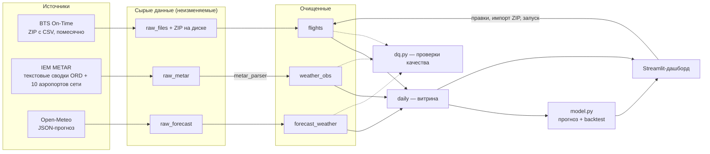

# Архитектура

Все шаги — функции-«джобы» с одинаковой обвязкой (`pipeline.py`): запись в журнал `load_log`,
watermark источника, ретраи HTTP, защита от параллельного запуска. Порядок цепочки:
`bts → metar → metar_network → openmeteo → weather (разбор METAR) → marts → model → dq`.
Ошибка одного шага пишется в журнал и не останавливает следующие.

## Запуск и автоматизация

| Как | Что происходит |
|---|---|
| `run.bat` | при первом запуске создаёт окружение, затем обновляет данные и открывает дашборд |
| `update.bat` | только обновление данных (`trigger = schedule`), лог в `data/scheduler.log` |
| `schedule_install.bat` | регистрирует `update.bat` в Планировщике заданий Windows — раз в час |
| кнопка «Обновить данные сейчас» | та же цепочка из интерфейса (`trigger = manual`), с демо-режимом сбоев |

Воспроизводимость: вся система поднимается с нуля одной командой; модель детерминирована (`random_state`),
каждая версия модели сохраняется в `model_runs` с метриками.

## Стек и почему

| Выбор | Почему | Что отвергли |
|---|---|---|
| **Python** | одна экосистема для загрузки, обработки, ML и интерфейса | — |
| **SQLite** | файл без сервера, транзакции, `ON CONFLICT` (upsert) — всё нужное для идемпотентности; ~250 МБ данных — для него немного | PostgreSQL — требует отдельного сервера, для учебного объёма избыточен |
| **pandas** | агрегации витрины, сопоставление вылетов с погодой (`merge_asof`) | — |
| **scikit-learn, HistGradientBoosting** | сильная модель для табличных данных, сама обрабатывает пропуски | статистические модели рядов — не используют погоду; нейросети — мало данных (~730 дней) |
| **библиотека `metar`** | разбор числовых групп METAR; явления погоды разбираем сами | — |
| **Streamlit + Plotly** | интерактивный веб-интерфейс на чистом Python: фильтры, редактируемые таблицы, графики с подсказками | React/BI-платформы — отдельный стек и больше кода без выигрыша для задачи |
| **Планировщик Windows** | встроен в ОС, запускает обновление без открытого дашборда | Airflow/Prefect — серверы и настройка ради одной цепочки |

Палитра графиков проверена на различимость при дальтонизме; цвета статусов (зелёный/жёлтый/красный)
всегда дублируются значком.
