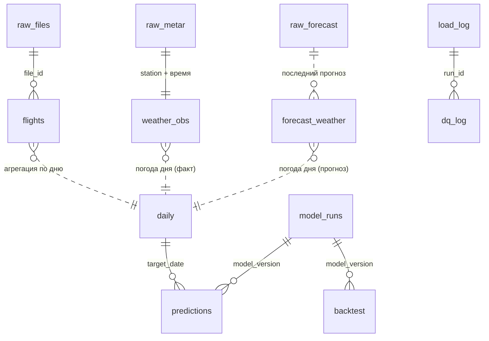

# Модель данных

Полная схема — `schema.sql`. Слои: **raw** (как пришло) → **очищенные** → **витрина** → **прогноз**; плюс служебные.

| Таблица | Слой | Ключ | Содержимое |
|---|---|---|---|
| `raw_files` | raw | (source, sha256) | скачанные ZIP BTS: период, URL, хэш, путь к файлу |
| `raw_metar` | raw | (station, время, текст) | сырые METAR-сводки |
| `raw_forecast` | raw | sha256 | сырые JSON-ответы Open-Meteo |
| `flights` | очищенные | дата, перевозчик, рейс, откуда, куда, время по плану | рейсы ORD (вылеты и прилёты): факт, задержки, отмены, причины; `is_manual`, `is_deleted` |
| `weather_obs` | очищенные | (station, время) | разобранный METAR: t°, ветер, порывы, видимость, потолок, явления, VFR/IFR |
| `forecast_weather` | очищенные | (станция, час UTC) | почасовой прогноз для ORD и аэропортов сети, единицы приведены к METAR (узлы, мили) |
| `daily` | витрина | дата (местная) | рейсы и задержки за день + погода дня в ORD (`w_*`) и в сети (`n_*` — доля рейсов, летящих в непогоду); `w_source` = metar/forecast |
| `predictions` | прогноз | (дата, цель, версия) | прогноз, интервал 10–90%, норма |
| `backtest` | прогноз | (версия, цель, дата) | прогноз vs факт на истории |
| `model_runs` | прогноз | версия | метрики и важность признаков каждой версии модели |
| `load_log` | служебная | id | **журнал загрузок**: параметры, статус, счётчики, HTTP/ретраи, watermark до/после, ошибка |
| `watermarks` | служебная | источник | докуда загружен источник |
| `dq_log` | служебная | id | результаты проверок качества |
| `edit_log` | служебная | id | аудит ручных правок: кто, что, было/стало |

Время: BTS — местное время аэропорта (`hhmm`), METAR и прогноз — UTC. В витрине всё приводится к
местной дате аэропорта (`America/Chicago`), при сопоставлении вылета с погодой — к UTC.

Объём на 16.11.2026: 1 337 399 рейсов (09.2024–08.2026, 13 перевозчиков), 23 588 METAR-сводок, БД ~250 МБ.
